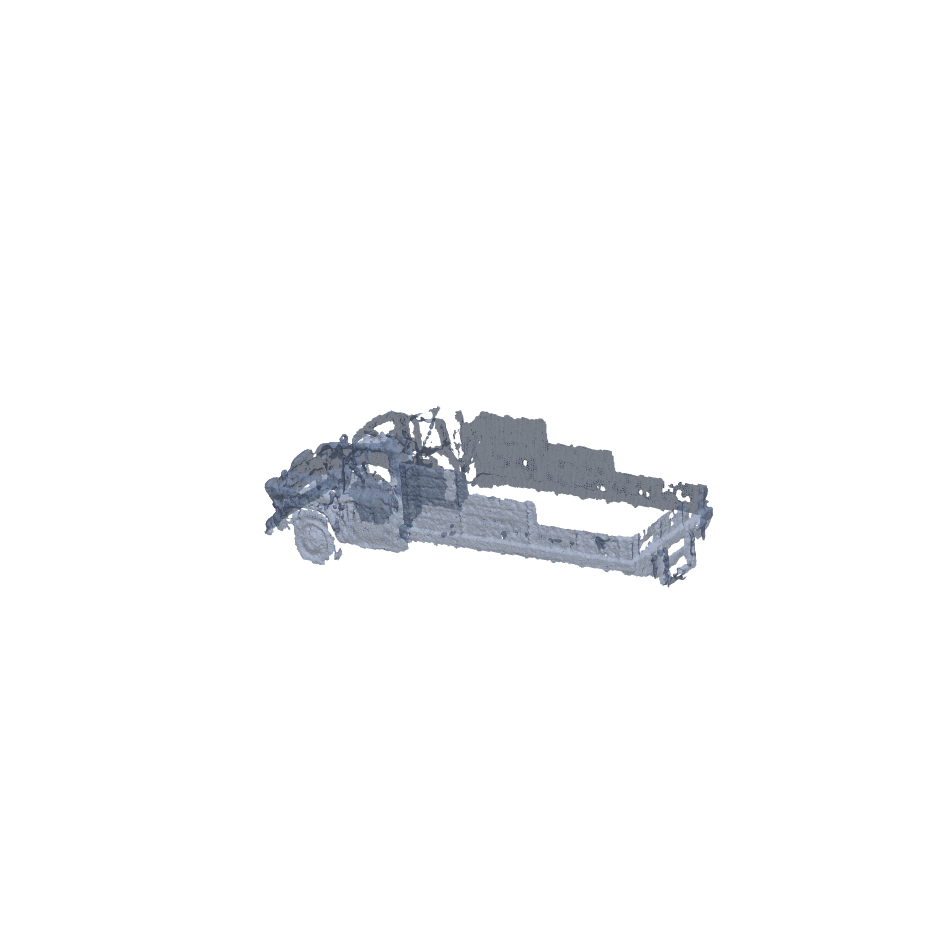
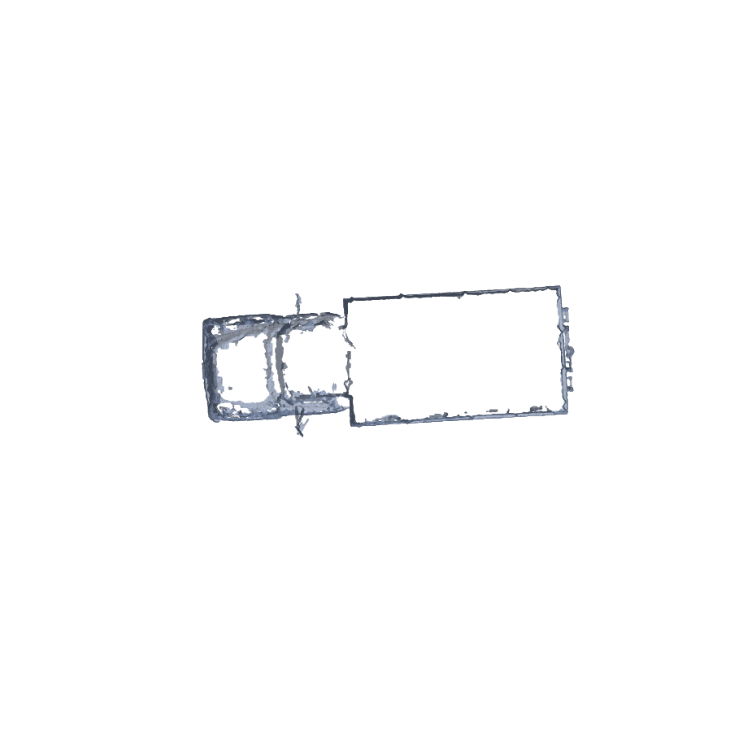
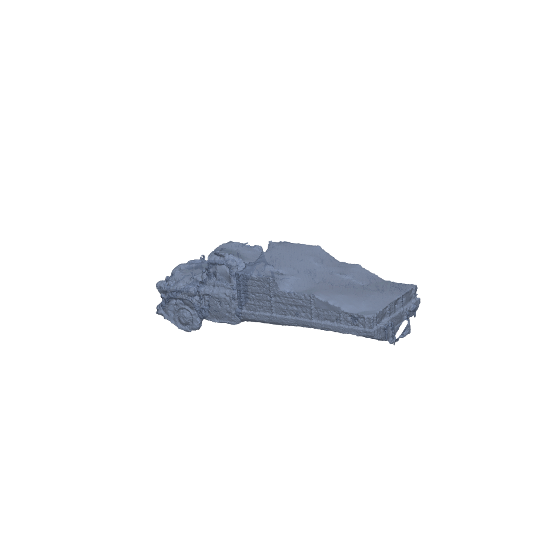

# Gruppe 7 — Objektrekonstruktion (Neural Rendering, VLM)

Kursprojekt, FH Technikum Wien. Ziel: aus 5–30 Fotos eines Objekts automatisch ein
3D-Modell (STL) rekonstruieren — mit 3D Gaussian Splatting (nerfstudio/splatfacto) und
sprachgesteuerter Segmentierung (Grounding DINO + SAM2), damit nur das benannte Objekt
(z. B. "the toy truck") im Mesh landet, nicht der Hintergrund.

Vollständiger Projektstatus, Architektur, Testergebnisse und offene Punkte:
siehe **[PROJECT_STATUS.md](PROJECT_STATUS.md)**.

## Anforderungs-Checkliste

Abgleich mit den Punkten der Aufgabenstellung — was umgesetzt ist und wo genau:

| # | Anforderung | Status | Umsetzung |
|---|---|---|---|
| 1 | 3D-Rekonstruktion aus Fotos | ✅ fertig | `ns-train splatfacto` (3D Gaussian Splatting), [`pipeline_clean.ipynb`](pipeline_clean.ipynb) Abschnitt 5 · Details: [PROJECT_STATUS.md §1](PROJECT_STATUS.md#1-status-nach-punkten-der-aufgabenstellung), [§3](PROJECT_STATUS.md#3-was-technisch-umgesetzt-wurde) |
| 2 | Sprachgesteuerte Segmentierung (Text → nur das genannte Objekt) | ✅ fertig | Grounding DINO + **SAM2**, 251/251 Masken erzeugt, [`pipeline_clean.ipynb`](pipeline_clean.ipynb) Abschnitt 4 |
| 3 | Masken vor/während dem Training angewendet (Hintergrund wird nie trainiert) | ✅ fertig | `ns-train ... --masks-path masks`, [`pipeline_clean.ipynb`](pipeline_clean.ipynb) Abschnitt 5 |
| 4 | Export als STL | ✅ fertig | Gaussians → Poisson-Mesh → STL, [`pipeline_clean.ipynb`](pipeline_clean.ipynb) Abschnitt 8 · Ergebnis: [`truck_object_30k.stl`](results/truck/truck_object_30k.stl) |
| 5 | (optional, ~10 %) Evaluierung vs. CAD-Referenz (Chamfer-Distanz) | ⚠️ Proxy fertig, echte CAD-Variante offen | Self-Consistency-Proxy: siehe [unten](#evaluierung). ABO-CAD-Vergleich ausgeführt, aber nicht aussagekräftig (Rekonstruktion geometrisch falsch, [PROJECT_STATUS.md §8](PROJECT_STATUS.md#8-was-noch-zu-tun-bzw-zu-prüfen-ist), Punkt 2). Nächster Schritt: Vergleich gegen die Druck-STL der [Figur](#eigene-fotos-3d-gedruckte-figur) |
| — | Zielszenario: eigene Fotos eines echten Objekts | ✅ fertig (STL) | 3D-gedruckte Figur, 43 eigene Smartphone-Fotos: COLMAP 43/43, Masken 43/43, STL nach Masken-Carving — [`notebooks/photos_to_stl.ipynb`](notebooks/photos_to_stl.ipynb), siehe [unten](#eigene-fotos-3d-gedruckte-figur) |
| — | Wenige Fotos (5–30) | ✅ getestet (truck-Teilmengen) | Sparse-View-Test bei n=12/20/24/30, siehe [PROJECT_STATUS.md §4](PROJECT_STATUS.md#4-sparse-view-test-funktioniert-die-pipeline-mit-530-fotos) |
| — | STL druckbar (watertight) | ✅ fertig | `truck_object_30k.stl` lokal mit `pymeshfix` repariert → [`truck_object_30k_watertight.stl`](results/truck/truck_object_30k_watertight.stl), siehe [PROJECT_STATUS.md §8](PROJECT_STATUS.md#8-was-noch-zu-tun-bzw-zu-prüfen-ist), Punkt 4 |

Methodenvorgabe eingehalten: ausschließlich 3D Gaussian Splatting, kein NeRF, kein
Methodenvergleich.

## Ergebnis (Visualisierung)

| Isometrisch | Draufsicht | Watertight-Version |
|---|---|---|
|  |  |  |

Erste beide gerendert aus [`truck_object_30k.stl`](results/truck/truck_object_30k.stl) (342 342 Dreiecke,
30 000 Trainingsiterationen, nach Hintergrund-Maskierung + DBSCAN-Ausreißerfilterung).
Dritte Ansicht aus der lokal mit `pymeshfix` reparierten, **druckbaren (watertight)**
Version [`truck_object_30k_watertight.stl`](results/truck/truck_object_30k_watertight.stl)
(560 156 Dreiecke).

> **Fehlt noch:** ein Vorher/Nachher-Vergleich mit 1–2 Original-Fotos aus dem
> `truck`-Datensatz und der zugehörigen SAM2-Segmentierungsmaske. Diese liegen nur auf
> Colab/Google Drive (`/content/tandt/truck/images`, `/content/tandt/truck/masks`) — hier
> lokal nicht vorhanden. Zum Ergänzen: aus Colab je ein Originalbild und die passende
> `masks/<gleicher-name>.png`-Datei herunterladen und unter `docs/images/` ablegen
> (z. B. `photo_original.jpg`, `photo_mask.png`), dann sage Bescheid — ich baue sie ins
> README ein.

## Evaluierung

Die Aufgabenstellung sieht optional (~10 % der Bewertung) einen Vergleich der
rekonstruierten STL-Geometrie mit einem **externen CAD-Referenzmodell** (Chamfer-Distanz)
vor. Bis zum Figur-Lauf war kein passendes physisches Objekt mit auffindbarem CAD-Modell verfügbar.

**Stattdessen umgesetzt: Selbstkonsistenz-Test (Proxy, kein CAD-Vergleich).** Die volle
251-Foto-Rekonstruktion dient als Pseudo-Referenz; eine Sparse-Rekonstruktion aus 30
Fotos (22 registrierte Bilder) wird nach Ausrichtung (Normalisierung + Rotationssuche +
ICP) dagegen verglichen. Ergebnis: ICP-Inlier-RMSE 0,0263, bidirektionale
Chamfer-Distanz 0,2497 (beide auf Objektgröße normiert) — Grundform stimmt überein, aber
ein spürbarer Teil der Sparse-Geometrie weicht von der Referenz ab.

**Wichtig:** Das ist ausdrücklich **kein** Vergleich mit einem externen CAD-Modell, wie
im Aufgabentext gefordert, sondern ein selbst gewählter Ersatz-Ansatz, weil kein
Referenzobjekt verfügbar war. Diese Einschränkung sollte im Bericht/bei der Abgabe klar
benannt werden, statt die Proxy-Metrik als die geforderte CAD-Auswertung darzustellen.
Volle Methodik: [PROJECT_STATUS.md §5](PROJECT_STATUS.md#5-evaluierung-chamfer-distanz).

## Eigene Fotos: 3D-gedruckte Figur

Erster Lauf der Pipeline auf **selbst aufgenommenen Fotos** (2026-10-25) — genau das Szenario der Aufgabenstellung:
eine 3D-gedruckte Figur (schwarzes PLA), **43 Smartphone-Fotos** (iPhone, 4032×3024, für COLMAP auf 1200×1600
verkleinert), Rundgang um die stehende Figur auf drei Höhen, gesprenkelter Boden als Textur. Textprompt: `"a figurine."`

| Schritt | Ergebnis |
|---|---|
| COLMAP (Kameraposen) | **43/43 Bilder registriert** ("COLMAP found poses for all images") — zum Vergleich: truck-Teilmengen 73–75 %, ABO-Drehteller 2/72 |
| Grounding DINO + SAM2 (Masken) | **43/43**, 0 Bilder ohne Box, visuell sauber (keine abgeschnittenen Gliedmaßen) |
| splatfacto-Training (7000 Iter., Masken) | fertig, 125 573 Gaussians |
| Mesh ohne Carving (wie bei truck: DBSCAN) | ❌ Figur in einer Wolke aus Hintergrund-Gaussians, Bounding Box 3,1 × 3,0 × 2,1 |
| **Mesh mit Masken-Carving** | ✅ **31 038 Gaussians → STL mit 199 253 Dreiecken**, Bounding Box 0,83 × 0,63 × 0,84; Figur klar erkennbar (Schulterpanzer, Rucksack, Arme, Beine); Beine dünner/lückenhafter als der Torso; Unterseite offen |

**Neuer Pipeline-Schritt: Masken-Carving (Visual Hull).** splatfacto initialisiert die Gaussians aus der
COLMAP-Punktwolke des *ganzen Raums*. Die Masken verhindern nur, dass Hintergrund-Gaussians trainiert werden — gelöscht
werden sie nicht. Beim truck trennte DBSCAN sie ab, bei der Figur waren Boden und Figur zu einem Cluster verwachsen.
Lösung: jedes Gaussian-Zentrum in alle 43 Kameras projizieren und nur behalten, wenn es in ≥ 90 % der Ansichten
innerhalb der SAM2-Maske liegt. Damit werden die Masken nicht nur beim Training, sondern auch beim Mesh-Export
genutzt. Details: [`notebooks/photos_to_stl.ipynb`](notebooks/photos_to_stl.ipynb), Abschnitt 7.

Bewährte Aufnahmeregeln (stehen auch im Notebook): Objekt bleibt stehen, man geht selbst herum; 2–3 Runden auf
verschiedenen Höhen; texturierter Untergrund; gleichmäßiges Licht, kein Blitz, kein Zoom; Fotos als Original-Datei
übertragen (Messenger komprimieren sonst auf ~1 MP und entfernen EXIF).

Da die Figur 3D-gedruckt ist, existiert ihr Druck-STL — damit ist eine **echte CAD-Evaluierung** (Chamfer-Distanz
gegen die Original-Druckdatei) möglich, sobald diese Datei vorliegt.

## Web-App: Fotos hochladen → STL

[`app/`](app/) macht die Pipeline als Webseite nutzbar (Gradio): 30–45 Fotos hochladen, kurz beschreiben, was zu
sehen ist („a figurine“), nach ~30 min 3D-Vorschau im Browser + STL-Download.

**Starten:** in Google Colab (T4-GPU) den Inhalt von [`app/colab_start.py`](app/colab_start.py) in **eine** Zelle
kopieren und ausführen (oder [`notebooks/web_app.ipynb`](notebooks/web_app.ipynb) öffnen). Die Zelle baut die
Umgebung, holt den Code aus diesem Repository und gibt einen öffentlichen Link `https://….gradio.live` aus.

| Datei | Inhalt |
|---|---|
| [`app/app.py`](app/app.py) | Oberfläche + Ablauf mit Fortschrittsanzeige und Plausibilitätsprüfungen (genug Fotos, COLMAP-Registrierung ≥ 60 %, Objekt auf ≥ 70 % der Fotos gefunden) |
| [`app/style.py`](app/style.py) | Design: gebrochenes Weiß, Weiß, Dunkelgrau, Hellblau, Akzente in Bordeaux und Smaragd — plus ein paar versteckte ♉-Details |
| [`app/pipeline.py`](app/pipeline.py) | Pipeline-Schritte: Fotos vorbereiten (EXIF, HEIC), COLMAP, Grounding DINO + SAM2, splatfacto |
| [`app/hull.py`](app/hull.py) | Mesh aus trainierter Szene + Masken: Visual Hull (Voxel-Carving 256³ auf der GPU) → Marching Cubes → wasserdichte STL |

## Repository-Struktur

| Pfad | Inhalt |
|---|---|
| [`app/`](app/), [`notebooks/web_app.ipynb`](notebooks/web_app.ipynb) | **Web-App** (siehe oben) |
| [`notebooks/photos_to_stl.ipynb`](notebooks/photos_to_stl.ipynb) | **Saubere, allgemeine Pipeline:** eigene Fotos + Textprompt → STL. Für ein neues Objekt nur Fotoordner und Prompt ändern |
| [`pipeline_clean.ipynb`](pipeline_clean.ipynb) | Vollständiges Arbeits-/Experimentprotokoll mit Zellausgaben: truck (Abschnitte 1–8), Sparse-View-Tests, Chamfer-Evaluierung, ABO-Test (Abschnitt 9), erster Figur-Lauf (letzte Zellen) |
| [`notebooks/archive/pipeline_v1.ipynb`](notebooks/archive/pipeline_v1.ipynb) | Erste Notebook-Version (SAM v1), nur historisch |
| [`results/truck/`](results/truck/) | truck-Ergebnis: [`truck_object_30k.stl`](results/truck/truck_object_30k.stl) (nicht watertight), [`truck_object_30k_watertight.stl`](results/truck/truck_object_30k_watertight.stl) (mit `pymeshfix` repariert, druckbar), `truck_positions.json` (Hilfsdaten für den 3D-Viewer) |
| [`results/figurine/`](results/figurine/) | Figur aus eigenen Fotos: [`figurine_object_carved.stl`](results/figurine/figurine_object_carved.stl) (Gaussian-Carving + Poisson; Torso gut, Beine lückenhaft) |
| [`results/abo_chair/`](results/abo_chair/) | ABO-Sessel (dense / N=30) — **geometrisch unbrauchbar**, siehe [PROJECT_STATUS.md §8](PROJECT_STATUS.md#8-was-noch-zu-tun-bzw-zu-prüfen-ist) |
| [`docs/images/`](docs/images/) | Renderings für dieses README |
| [`paper/`](paper/) | Wissenschaftliche Ausarbeitung (IEEE-Template) |
| [`PROJECT_STATUS.md`](PROJECT_STATUS.md) | Ausführliches Übergabedokument: Status, Umgebung, Ergebnisse, Evaluierung, bekannte Probleme |

Eingabefotos werden nicht ins Repository eingecheckt (Größe; liegen auf Google Drive).

## Ausführen

Auf **Google Colab** mit GPU (T4):

1. [`notebooks/photos_to_stl.ipynb`](notebooks/photos_to_stl.ipynb) in Colab öffnen (VS-Code-Colab-Erweiterung oder
   [colab.research.google.com](https://colab.research.google.com)), Laufzeit mit T4 verbinden.
2. Fotos als Ordner auf Google Drive legen; in Abschnitt 3 `DRIVE_PHOTOS` und `OBJECT_PROMPT` anpassen.
3. Zellen der Reihe nach ausführen (Umgebung ~30 min beim ersten Mal, COLMAP ~15 min, Masken ~1 min, Training ~10 min).

Details zur Umgebung (venv-Aufbau, Abhängigkeiten, bekannte Stolpersteine): [PROJECT_STATUS.md](PROJECT_STATUS.md), Abschnitt 2.
